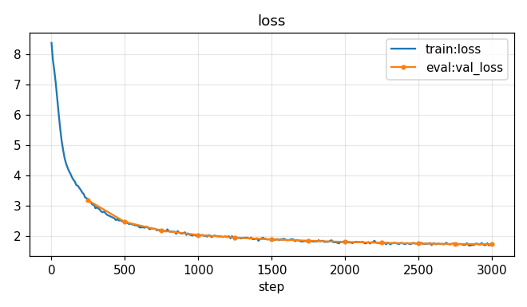
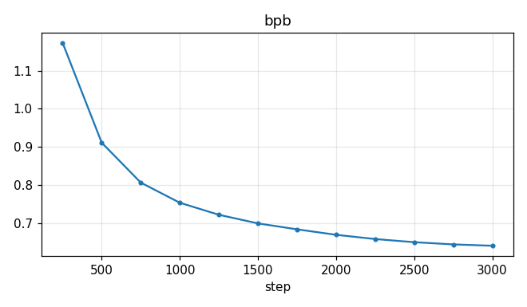
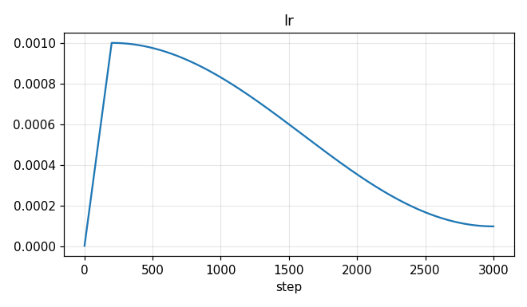
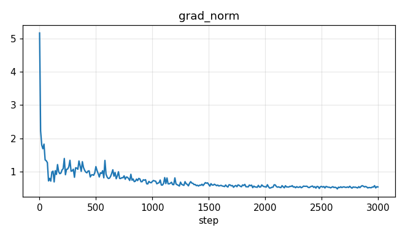
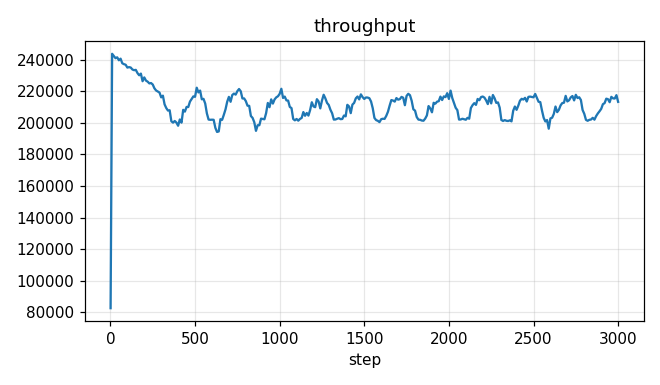

# Run report: m1-tinystories-20261101-213014-547c860

## Run card

- Git: `547c860bd988dd4b6fa2153c8b9385cc1fd6633b`
- Hardware: Tesla T4 (CUDA: True), torch 2.11.0+cu128, Python 3.13.15
- Model: 6 layers, d_model 256, 8 heads, context 256, vocab 4096
- Training: 3000 steps × 65,536 tokens, lr 0.001, warmup 200, seed 1337, precision auto
- Versions: data `tinystories-v1`, tokenizer `tinystories-bpe-v1`, shards `tinystories-shards-v1`

## Data card

- Source: `roneneldan/TinyStories`, license **CDLA-Sharing-1.0**
- Documents: received 2,119,719, kept 1,799,248; dropped exact_duplicate 320,241, invalid_utf8 0, too_long 0, too_short 230
- Splits: test 18,003 docs, train 1,763,298 docs, val 17,947 docs

## Tokenizer card

- Byte-level BPE, vocab 4,096, trained on 100,000,218 bytes in 14.29 s
- Compression: 3.93 bytes/token
- Tokens: test 4,117,851, train 401,420,049, val 4,068,588

## Charts

## Results

| metric | value |
|---|---:|
| final val_loss | 1.738 |
| best val_loss | 1.738 |
| final bpb | 0.6405 |
| final ppl | 5.688 |
| final repetition | 0.1458 |
| final train loss | 1.722 |
| steps | 3,000 |
| tokens | 196,608,000 |
| wall time (s) | 1014 |
| cost (USD) | 0 |

## Sample progression

**Once upon a time, there was a little dog named**

- step 250: Max. Max was very sad and said, "I'm sorry, Lily. I'm sorry, Lily. I'm sorry, but I'm sorry. I'm sorry, but you are you are not mean to play with me. You are very good. You are very good. You are very good. You are very good. You are very good. You are very good. You are very good. You are very good
- step 1750: Max. Max loved to play with his ball and run around in the park. One day, Max saw a big, red ball in the park. Max wanted to play with the ball, but he was too small to reach it.  Max tried to reach the ball, but he couldn't reach it. He asked his friend, a wise old owl, for help. The owl said, "I c
- step 3000: Spot. Spot loved to play with his ball and run around in the park. One day, Spot saw a big, scary dog. The dog was barking and running around. Spot was scared and ran away.  Spot's owner saw him and said, "Don't worry, Spot. I will help you." She took Spot to the vet. The vet was very nice and gave 

**Lily wanted to go to the park, but**

- step 250: she was very happy. She saw a big tree and a big tree. She was very happy and happy.  One day, Lily saw a big tree with a big tree. She was very happy and wanted to play with her friends. She said, "I'm so pretty, Lily, Lily, Lily, Lily, Lily, Lily. I'm playing with me. I'm so happy to play with me.
- step 1750: her mom said it was too dangerous. Lily was sad and didn't know what to do. She went to the park and saw a boy playing with a ball. She asked him if he could play with her. The boy said yes and they played together.  Lily was happy that she could help her friend. She learned that it's important to b
- step 3000: her mom said no. She said it was too dangerous. She said it was too dangerous. She said she would be back soon.  Lily was sad. She did not want to go to the park. She wanted to play with her friends. She wanted to go to the park. She did not want to go to the park. She wanted to go to the park.  She

**Tom found a big red ball in the garden. He**

- step 250: was very happy and he had a big, and a big, and a big, and a big, and a big, and a big, and a big, and a big, and a big, and a big, and a big, and a big, and a big, and a big, and a big, and a big, and a big, and a big, and a big, and a big, and a big, and a big, and a big, and a big, and a big, and
- step 1750: wanted to play with it. He took the ball and ran to the ball. He threw the ball to the ball and the ball went far away. He was very happy.  But then, a big dog came and took the ball from Tom. The dog was scared and ran away. Tom was very sad and cried. He wished he had listened to his mom.  The nex
- step 3000: picked it up and started to play with it. He threw it up in the air and laughed. He had so much fun with the ball.  But then, he saw a big dog. The dog was barking and running towards him. Tom was scared and ran away. He did not want to play with the ball. He wanted to play with the ball.  Tom ran a

**One day, a little bird could not fly because**

- step 250: it was too big and it was very happy. The bird was so happy and the bird was so happy.  The little girl was so happy and she had a big, and the bird was a big, and the bird was very happy. The bird was so happy and the bird was so happy.
- step 1750: it was very sad. The bird wanted to help the bird, so it flew to the top of the tree. The bird saw the bird and flew to help.  The bird flew to the top of the tree and saw the bird. The bird was very happy and flew away. The bird was happy too. The bird and the bird became good friends. They played 
- step 3000: it was too high. The bird wanted to fly high in the sky, but it was too small. The bird tried to fly, but it was too small.  The bird had an idea. It flew to the sky and found a big tree. The bird was very happy and flew to the tree. The bird was very happy and flew away.  The bird flew back to the 

**The sun was hot, so Mia and her mom**

- step 250: said, "I'm a big, Lily. You are very good at the park."  Lily and Ben were happy. They had a big dog. They had a big dog. They had a big dog. They liked to play with their toys. They had a big dog. They liked to play with their toys. They had a big dog. They liked to play with their toys. They had a
- step 1750: went to the park. Mia saw a big slide and wanted to go down it. She ran to the slide and climbed up. She was very happy.  Mia saw a boy sitting on the slide. He looked sad. Mia wanted to help him. She went to the slide and sat down. She saw a boy sitting on the slide. He looked sad.  Mia went to the
- step 3000: went to the park. Mia saw a big slide and wanted to go down it. She ran to the slide and climbed up the ladder. She was ready to go down the slide.  Mia ran to the slide and climbed up the ladder. She felt the wind in her hair and the sun on her face. She felt the wind in her hair and the sun on her

**Ben was sad because his toy was broken. His friend**

- step 250: was very happy. He was very happy and he had a big hug. He said, "I'm a good friend, I'm a little boy. I'm a little boy, I'm a little boy. I was very happy and he was very happy.
- step 1750: was sad and didn't know what to do. He looked around and saw a big box. He thought it was a toy and he wanted to play with it.  He went to his friend, a little girl named Lily. Lily saw the toy and said, "Wow, that's a nice toy! Can I play with it?"  Lily said, "Sure, you can play with it. But be ca
- step 3000: , a little girl named Lily, saw him crying. She asked him what was wrong. Ben told her about his broken toy. Lily said, "Don't worry, I can help you fix it."  Lily and Ben worked together to fix the toy. They used glue to glue the toy back together. When they were done, Lily's toy was fixed. She was

**In a small house near the forest, there lived**

- step 250: a big, a little girl named Lily. She loved to play with her friends. One day, Lily's mom came to the park. She saw a big tree with her. She was very happy and wanted to play with her friends.  Lily was sad and said, "I'm sorry, Lily. I'm sorry, Lily. I'm sorry, Lily. I'm sorry, Lily. I'm sorry, but 
- step 1750: a little girl named Lily. Lily loved to play with her toys and her friends. One day, Lily's mom told her that they were going to the park to play. Lily was so excited!  When they got to the park, Lily saw a big slide. She wanted to go on it, but her mom said it was too high. Lily was sad and didn't 
- step 3000: a little girl named Lily. Lily loved to play with her toys and run around outside. One day, Lily's mom asked her to help her put the toys in the boxes. Lily was happy to help her mom.  Lily's mom showed her how to put the toys in the boxes. Lily was so excited to help her mom. She put the toys in th

**Sara looked at the sky and saw**

- step 250: a big, and a big, and a big, and a big, and a big, and a big, and a big, and a big, and a big, and a big, and a big, and a big, and a big, and a big, and a big, and a big, and a big, and a big, and a big, and a big, and a big, and a big, and a big, and a big, and a big, and a big, and a big, and a b
- step 1750: the big, red sky. She felt happy and proud. She wanted to see the big, red sky. She wanted to see the big, red, yellow, and yellow. She wanted to see the big, red, yellow, and yellow.  She ran to the big, red, red, and yellow. She saw a big, red, yellow, and yellow. She wanted to touch the big, red,
- step 3000: the clouds. She saw the clouds and the clouds. She saw the clouds and the clouds. She saw the clouds and the clouds. She saw the clouds and the clouds. She saw the clouds and the clouds. She saw the clouds and the clouds. She saw the clouds and the clouds. She saw the clouds and the clouds. She saw 

**The cat and the dog did not like each other. One day,**

- step 250: the dog came to the dog. The dog was scared. The dog was scared. The dog was scared. The dog was scared. The dog was scared. The dog was scared. The dog was scared. The dog was scared. The dog was scared. The dog was scared. The dog was scared. The dog was scared. The dog was scared. The dog was sca
- step 1750: the cat and the dog went to the park. The cat was sad and lonely. The cat wanted to be friends with the cat.  The cat and the dog played together. They had fun and became good friends. The cat and the dog became good friends. They played together and had lots of fun. The cat was happy to have a new 
- step 3000: the cat and the dog were playing in the park. The cat wanted to play with the dog, but the dog was too fast. The cat ran away and the dog chased after the cat. The cat was very sad and cried a lot. The dog and the dog were very sad.

**"Can I help you?" asked the kind old man.**

- step 250: The man said, "I'm sorry, I'm sorry, I'm sorry, I'm sorry, but you are you are you. I'm sorry, you are you. You are very good. You are very good. You are very good. You are very good. You are very good. You are very good. You are very good. You are very good. You are very good. You are very good. Yo
- step 1750: "Sure, you can help me," said the old man.  The old man smiled and said, "Thank you, little one. You are very kind."  The old man thanked the old man and went back to the park. He was happy to help the old man.
- step 3000: "Sure, you can help me," said the old man.  The old man was very happy. He thanked the old man and went on his way.  The old man and the old man became good friends. They played together every day. And they lived happily ever after.

## Resume log

- resumed from step 500 (step_00000500.pt)

## Known limitations

# Known limitations

- ~6M parameters trained on synthetic TinyStories only: simple children's-story English.
- No instruction tuning; it continues text rather than answering questions.
- Single run, single seed; no ablations yet.
